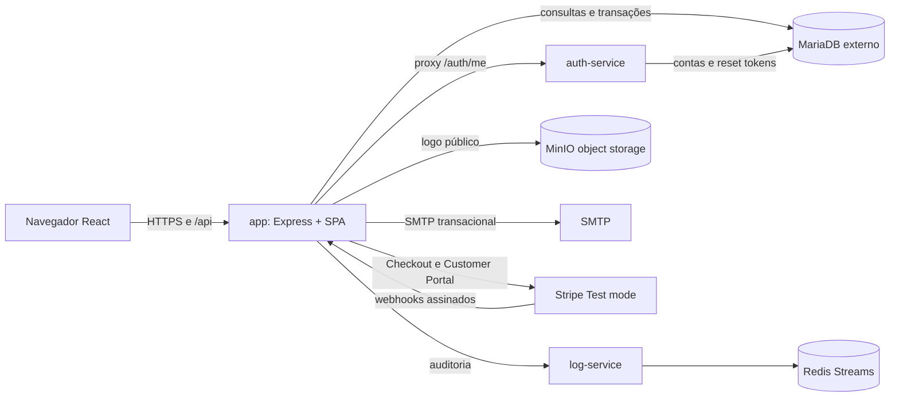
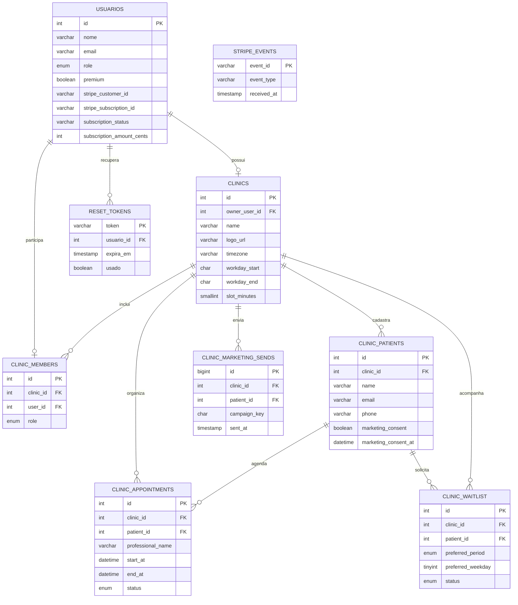

# Documentação reversa — AgendaLivre

Este documento descreve a implementação presente na branch `agendalivre`. Funcionalidades que dependem de credenciais, configuração externa ou implantação não são declaradas como executadas.

## 1. Especificação funcional

### Produto e perfis

AgendaLivre é um painel operacional para consultórios: organiza agenda, cadastros mínimos de contato, lista de espera, horários cancelados e comunicações administrativas autorizadas. Não é prontuário e não deve receber sintomas, diagnósticos ou conteúdo clínico.

- **Proprietário:** configura o consultório, gerencia a equipe, faz billing e possui todos os acessos do domínio.
- **Recepção:** consulta a rotina e pode cadastrar pacientes, atualizar consentimentos e administrar a lista de espera e os atendimentos.
- **Profissional:** consulta dados do consultório e cria/atualiza seus próprios atendimentos; o backend usa o nome validado da sessão.
- **Admin da plataforma:** papel global separado, autorizado a consultar métricas de billing e eventos de auditoria.
- **Free/Pro:** plano comercial distinto de papéis. A conta proprietária define o estado da assinatura do consultório.

### Telas e rotas do frontend

- `/`: landing page pública com proposta de valor, recursos e plano Free.
- `/login`: login, cadastro e recuperação de senha.
- `/reset-password`: valida e consome token de redefinição.
- `/app`: painel AgendaLivre para proprietário/equipe ou painel de billing para conta `admin`.

O token é armazenado em `localStorage`; o backend valida a identidade via `auth-service`. O frontend não concede plano nem autorização. O retorno do Stripe apenas informa a interface para consultar o estado novamente.

### API pública

Todas as rotas abaixo são servidas pelo Express (`app`). `Bearer` significa token validado pelo `auth-service`; `membro` implica vínculo a um consultório resolvido pelo middleware `clinicAccess`.

| Método e rota | Acesso | Regra observada |
| --- | --- | --- |
| `POST /api/auth/register` | Público | Cadastra uma conta proprietária com senha bcrypt e JWT. |
| `POST /api/auth/login` | Público | Valida credenciais e retorna sessão. |
| `POST /api/auth/forgot-password` | Público | Cria token de recuperação e envia e-mail quando configurado. |
| `GET /api/auth/reset-password/validate?token=...` | Público | Verifica token não usado e dentro da validade. |
| `POST /api/auth/reset-password` | Público | Atualiza senha e consome o token em transação. |
| `GET /api/auth/me` | Bearer | Valida sessão pelo serviço de autenticação. |
| `GET /api/clinic/dashboard` | Membro | Retorna clínica, papel local, estado do plano e métricas. |
| `PUT /api/clinic/settings` | Proprietário | Atualiza nome e horário de funcionamento. |
| `GET/POST/DELETE /api/clinic/members[/:userId]` | Proprietário | Lista, vincula conta existente e remove recepção/profissional. |
| `POST /api/clinic/logo` | Proprietário | Recebe arquivo multipart `logo`, valida extensão/MIME/tamanho e grava no MinIO. |
| `GET /api/patients` | Membro | Lista pacientes daquele consultório; para profissional, somente pacientes com atendimento associado ao próprio nome de sessão. |
| `POST /api/patients` | Proprietário/recepção | Cadastra nome, e-mail, telefone e consentimento explícito. |
| `PATCH /api/patients/:id/marketing-consent` | Proprietário/recepção | Atualiza consentimento dentro do consultório. |
| `GET /api/appointments` | Membro | Lista atendimentos da clínica; para profissional, somente os associados ao próprio nome de sessão. |
| `GET /api/appointments/:id` | Membro | Consulta detalhe com validação de clínica e, para profissional, do próprio atendimento. |
| `POST /api/appointments` | Membro | Valida paciente, duração e conflito de horário; Free tem limite mensal. |
| `PUT /api/appointments/:id` | Membro | Remarca; rejeita conflito, paciente de outro tenant ou atendimento concluído. |
| `DELETE /api/appointments/:id` | Membro | Cancela logicamente atendimento agendado/confirmado e preserva histórico. |
| `PATCH /api/appointments/:id/status` | Membro | Atualiza status; profissional só pode alterar seu próprio atendimento. |
| `GET /api/waitlist` | Membro | Lista entradas daquela clínica. |
| `POST /api/waitlist`, `PATCH /api/waitlist/:id/status` | Proprietário/recepção | Adiciona e atualiza lista de espera. |
| `GET /api/premium/reactivation-candidates` | Membro de consultório Pro | Retorna sugestões administrativas de retorno, sem dados clínicos. |
| `POST /api/premium/campaigns` | Proprietário Pro | Envia e-mail apenas para contatos selecionados com consentimento ativo; cota de 200/mês. |
| `GET /api/public/unsubscribe` | Público + assinatura HMAC | Revoga consentimento para a combinação clínica/paciente. |
| `POST /api/billing/checkout` | Proprietário | Cria Checkout Session com `mode=subscription`, preço definido no servidor. |
| `GET /api/billing/status` | Proprietário | Consulta plano e estado local. |
| `POST /api/billing/portal` | Proprietário | Cria sessão do Stripe Customer Portal. |
| `POST /api/billing/cancel` | Proprietário | Agenda cancelamento no fim do período no Stripe. |
| `POST /api/billing/webhook` | Stripe | Valida assinatura do corpo original e deduplica eventos. |
| `GET /api/admin/billing/summary` | Bearer + `admin` | Retorna Free/Pro, assinaturas ativas e MRR em centavos. |
| `GET /api/admin/logs?limit=50` | Bearer + `admin` | Consulta eventos recentes via log-service. |

As rotas `/api/auth/*` são encaminhadas ao serviço interno de autenticação. O webhook Stripe é registrado antes do middleware Bearer e usa a validação de assinatura Stripe.

## 2. Arquitetura e implantação

### Componentes e redes

| Componente | Responsabilidade |
| --- | --- |
| `frontend/` | React/Vite; o build fica servido pelo processo `app`; landing pública em `/`. |
| `backend/` (`app`) | API, RBAC de domínio, isolamento, Stripe, MinIO, logs e frontend estático. |
| `auth-service/` | Cadastro, login, validação de token, RBAC global e recuperação de senha. |
| `log-service/` | Recebe eventos e lê o Redis Stream de auditoria. |
| Redis | Persistência do stream `auditoria_logs`; só rede Docker. |
| MariaDB | Banco externo configurado via `DB_HOST`, `DB_USER`, `DB_PASS`, `DB_NAME`. |
| MinIO | Bucket `agendalivre-assets`; guarda logos, não arquivos de pacientes. API e console são expostos pelo Compose nas portas configuradas. |
| Stripe | Checkout, assinatura, portal e webhooks exclusivamente em modo de teste se `sk_test_` for usada. |
| SMTP | E-mail de senha e campanhas administrativas; credenciais somente em ambiente. |

`docker-compose.yml` constrói o app e serviços auxiliares; não cria MariaDB. O deploy na VM e o subdomínio precisam ser configurados externamente, não são comprovados pelo repositório.

### Fluxo de uma requisição de domínio

1. O navegador envia Bearer token à API publicada pelo `app`.
2. O middleware consulta `/auth/me` no serviço interno e obtém a identidade.
3. `clinicAccess` resolve `clinicId`, `clinicOwnerId` e papel local pelo proprietário ou por `clinic_members`; conta proprietária sem clínica ganha uma clínica inicial.
4. A rota aplica o papel permitido e usa `clinic_id` nas consultas. IDs recebidos do navegador nunca determinam o tenant.
5. A escrita consulta MariaDB; ações relevantes enviam eventos ao log-service/Redis; Express retorna JSON.

### Fluxo de assinatura e MRR

1. Proprietário inicia checkout; backend usa `STRIPE_PRO_PRICE_ID` e um Customer Stripe existente ou cria a sessão hospedada.
2. Cartão e dados de pagamento ficam no Stripe.
3. Webhook recebe `checkout.session.completed`, `customer.subscription.created`, `customer.subscription.updated`, `customer.subscription.deleted` ou `invoice.payment_failed`.
4. `constructEvent` verifica `Stripe-Signature` com o corpo bruto. `stripe_events.event_id` e a transação impedem reaplicar o mesmo evento.
5. Assinaturas `active`/`trialing` concedem Pro; `past_due`, canceladas e outros estados não concedem. Falha de cobrança revoga Pro localmente. O valor recorrente é normalizado para centavos mensais, inclusive quando o preço Stripe é anual.
6. O app usa o Customer Portal para troca/cancelamento; o estado final volta ao MariaDB via webhook. O painel admin soma o valor mensal de assinaturas ativas de teste.

O banco é uma cópia operacional sincronizada por webhooks, não a fonte autoritativa da Stripe. Eventos de uma assinatura antiga não substituem o ID de uma nova assinatura; atualizações fora de ordem do mesmo ID ainda dependem da ordem de entrega. Antes de produção convém consultar o estado canônico da assinatura no Stripe ou persistir versão temporal de eventos.

### Modelo de dados

### Segurança, papéis e isolamento

- Autenticação por JWT de 24 horas, senha com bcrypt, token de reset de uso único e expiração configurável.
- `admin` global é atribuído manualmente e necessário nas rotas administrativas. `owner`, `reception` e `professional` são papéis de domínio; vínculos ficam em `clinic_members`. `/auth/me` lê o papel atual do banco, então mudanças não dependem da expiração do JWT.
- Um usuário de equipe só pertence a um consultório como membro. Para vincular conta existente cujo consultório automático ainda esteja vazio, o sistema pode removê-lo; não move dados existentes.
- Rotas verificam função no backend. Proprietário gerencia equipe/configurações/billing, recepção administra cadastros e lista de espera, profissional tem seus atendimentos limitados pelo nome validado da sessão.
- Dados de pacientes e consultas são isolados por `clinic_id`; profissionais também têm as leituras de pacientes/consultas limitadas ao nome validado da sessão. Essa associação por nome não é um identificador imutável: a produção deve vincular cada atendimento à conta profissional por ID. A API evita persistir conteúdo clínico, mas nomes, contatos e horários continuam dados pessoais que exigem governança, retenção e proteção apropriadas.
- O bucket MinIO tem leitura pública para logos. A configuração não é apropriada para armazenar documentos, imagens ou dados de pacientes.
- Webhook exige chave `sk_test_` no ambiente atual; chaves e segredo do webhook não devem ser versionados.

## 3. Regras de negócio e limites

- Conta nova começa como proprietária. Ao acessar o domínio, recebe um consultório se ainda não existir; uma conta sem vínculo não acessa clínicas alheias.
- Só o proprietário modifica configurações, equipe, logo e billing. Papel é verificado a cada requisição.
- Só são aceitos status de atendimento conhecidos, duração entre 15 e 120 minutos de uma lista fixa e data com timezone explícito.
- Atendimentos sobrepostos para o mesmo profissional são recusados (`409`). Uma transação trava o registro do consultório durante validação e criação.
- Free permite três novos agendamentos por mês civil; tentativa seguinte responde `403 PLAN_LIMIT_REACHED`, com limite e instrução para upgrade. A trava de clínica serializa a checagem concorrente.
- Pro remove limite de agendamentos, libera sugestões administrativas, até 10 sugestões de lista de espera compatíveis por período/dia e no máximo 200 e-mails aceitos por mês. Campanhas filtram consentimento ativo e e-mail cadastrado e incluem descadastro HMAC.
- A franquia de campanha usa uma contagem antes do envio e inserts posteriores, sem uma transação que reserve a cota. Envios concorrentes podem exceder temporariamente a cota; isso deve ser corrigido antes de uso real.
- Sugestões de retorno consideram último atendimento concluído e ausência de consulta futura; são administrativas e não inferem condição de saúde.
- Status de assinatura Pro ativo é `active`/`trialing`. `past_due` é tratado como Free. O navegador não altera plano.
- MRR é soma em centavos de preços recorrentes ativos armazenados em `subscription_amount_cents`; preços semanais/anuais são normalizados para mês. Deve-se manter o preço de teste no Stripe coerente com o README.

## 4. Migrações e configuração

- `database/create.sql`: esquema inicial de usuário, assinatura, clínica, equipe, pacientes, consultas, lista de espera e campanhas.
- `auth-service/src/scripts/migrate.js`: adequa `usuarios.role` e cria `reset_tokens`; contas legadas `usuario` passam a proprietárias.
- `backend/src/scripts/migratePremium.js`: adiciona estado/identificadores/valor de assinatura e `stripe_events`.
- `backend/src/scripts/migrateClinic.js`: cria tabelas operacionais da clínica, equipe, consentimento e campanhas; adiciona referência do logo.
- `database/migrate-auth.sql`: alternativa manual de migração do papel e tokens.

Variáveis consultáveis em `.env.example`, `.env` local e `backend/.env.example`: `DB_*`, `JWT_SECRET`, `APP_PUBLIC_URL`, `AUTH_SERVICE_URL`, `LOG_SERVICE_URL`, `MINIO_*`, `SMTP_*`, `MARKETING_UNSUBSCRIBE_SECRET`, `STRIPE_SECRET_KEY`, `STRIPE_WEBHOOK_SECRET`, `STRIPE_PRO_PRICE_ID`, URLs Checkout/Portal. Os arquivos de exemplo não contêm credenciais reais.

## 5. Limitações conhecidas

1. Deploy, DNS, stack Portainer, configuração do Customer Portal, produto/preço Stripe e entrega de webhook dependem de acesso externo e ainda precisam de comprovação.
2. O timezone do consultório é armazenado, mas algumas agregações e exibições usam UTC ou timezone local do navegador; uma versão de produção deve padronizar conversões.
3. O serviço de autenticação consulta o papel global atual no banco em cada `/auth/me`, com custo de uma consulta adicional por requisição protegida.
4. Cotas de e-mail não têm reserva atômica; webhooks diferentes podem chegar fora de ordem; esses pontos precisam de hardening.
5. Ainda são necessários rate limiting, verificação de e-mail, política de retenção/exclusão, backup/restore testado, documentação de consentimento e revisão LGPD/segurança.
6. A landing page e as telas não constituem prova de entrevistas, métricas reais, faturamento, deploy ou entrega acadêmica.

O relatório P2 deve usar evidências verdadeiras de commits, publicação, Stripe e issues. Nenhum print, data, URL de produção ou resultado externo é simulado nesta documentação.
