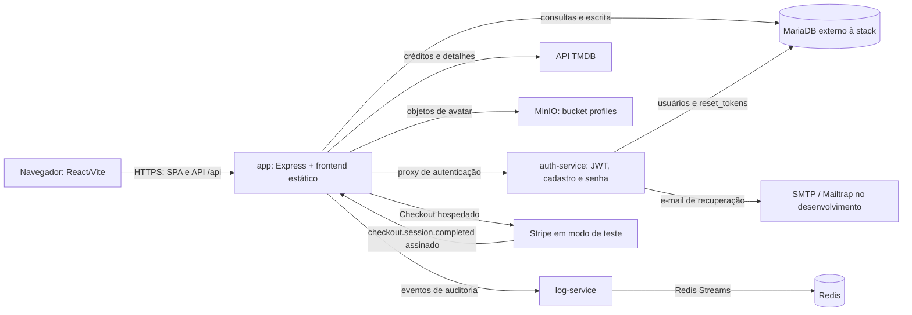
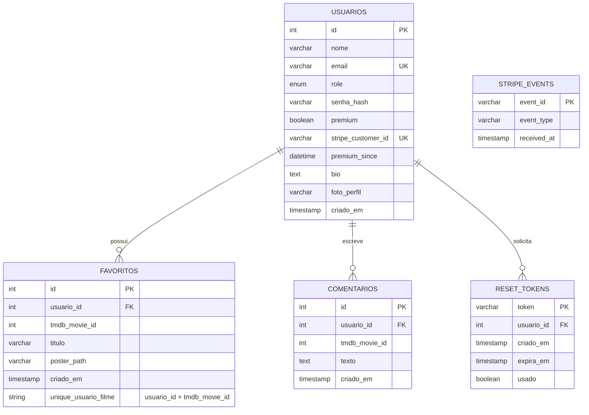

# Documentação reversa — Tom Hanks App

Este documento descreve o comportamento encontrado no repositório, incluindo o fluxo Premium adicionado na atividade de Stripe. É uma especificação do estado atual do código, não uma promessa de funcionalidades futuras.

## 1. Especificação funcional

### Objetivo e perfis

O sistema oferece um catálogo dos filmes de Tom Hanks obtidos do TMDB. Pessoas autenticadas podem consultar o catálogo, manter favoritos, comentar filmes e editar o próprio perfil. Há dois papéis de aplicação: `usuario` (padrão) e `admin`.

- **Usuário:** cadastra-se, entra, pesquisa o catálogo, cria/remove seus favoritos e comentários, consulta perfis e edita o próprio perfil.
- **Administrador:** além das ações comuns, pode moderar comentários de outras pessoas e consultar os eventos de auditoria.
- **Premium:** é um estado de acesso distinto do papel RBAC. No estado atual é concedido após uma compra única de teste confirmada pelo Stripe; permite salvar favoritos sem limite, enquanto o plano Free permite cinco.

### Telas

- `/login`: cadastro, login e solicitação de recuperação de senha.
- `/reset-password`: valida token e permite definir nova senha.
- `/`: catálogo autenticado, abas de filmes/favoritos, comentários, indicação do plano e início do checkout Premium.
- `/profile/:id`: perfil autenticado com bio, avatar e favoritos; edição aparece apenas para o titular.

O token e os dados básicos do usuário ficam em `localStorage` no frontend. O navegador volta do checkout com `?checkout=success` ou `?checkout=cancelled`; o status Premium é obtido novamente da API. O parâmetro de retorno não concede acesso.

### API do serviço público (`app`)

| Método e rota | Acesso | Comportamento |
| --- | --- | --- |
| `POST /api/auth/register` | Público | Cria usuário com papel `usuario`, senha em hash bcrypt e JWT. |
| `POST /api/auth/login` | Público | Valida credenciais e retorna usuário e JWT. |
| `POST /api/auth/logout` | Bearer | Registra o evento de logout; o cliente também apaga o token local. |
| `POST /api/auth/forgot-password` | Público | Inicia recuperação e envia link quando a conta existe; a mensagem de resposta é genérica. |
| `GET /api/auth/reset-password/validate?token=...` | Público | Verifica se o token existe, não foi usado e não expirou. |
| `POST /api/auth/reset-password` | Público | Atualiza a senha e marca o token como usado em uma transação. |
| `GET /api/auth/me` | Bearer | Retorna as claims do JWT validadas pelo `auth-service`. |
| `GET /api/movies` | Bearer | Consulta créditos de filmes da pessoa 31 no TMDB. |
| `GET /api/movies/:id/details` | Bearer | Consulta detalhes de um filme no TMDB. |
| `GET /api/favorites` | Bearer | Lista somente os favoritos da conta autenticada. |
| `POST /api/favorites` | Bearer | Adiciona favorito; Free fica limitado a cinco, Premium não tem limite. |
| `DELETE /api/favorites/:id` | Bearer | Remove somente favorito pertencente à conta autenticada. |
| `GET /api/comments` | Bearer | Lista comentários da conta; `tmdb_movie_id` pode filtrar por filme. |
| `POST /api/comments` | Bearer | Cria comentário associado à conta autenticada. |
| `DELETE /api/comments/:id` | Bearer | O autor remove o próprio comentário; admin também pode moderar comentários alheios. |
| `GET /api/profile/:id` | Bearer | Consulta dados do perfil e seus favoritos. |
| `PUT /api/profile/:id` | Bearer | Atualiza bio/avatar somente quando o ID solicitado é o do titular. |
| `POST /api/billing/checkout` | Bearer | Cria sessão Stripe Checkout hospedada, com preço e usuário definidos pelo servidor. |
| `GET /api/billing/status` | Bearer | Retorna plano e limite de favoritos consultando o MariaDB. |
| `POST /api/billing/webhook` | Stripe | Recebe o corpo original, valida assinatura e processa evento de pagamento de forma idempotente. |
| `GET /api/admin/logs?limit=50` | Bearer + admin | Consulta até 500 eventos mais recentes do log-service. |

As rotas `/api/auth/*` são encaminhadas pelo `app` ao `auth-service`. O middleware do `app` protege as demais rotas `/api`, com exceção explícita do webhook Stripe, que é público e autenticado pela assinatura do provedor.

## 2. Arquitetura e implantação

### Componentes e limites de rede

| Componente | Responsabilidade e conexão |
| --- | --- |
| `frontend/` | React/Vite; em produção, o build estático é servido pelo `app`. |
| `app` | Express, API de catálogo, proxy de autenticação, perfil/MinIO e integração Stripe. Publica a porta configurada por `RESERVED_PORT` para a porta interna 3000. |
| `auth-service` | Cadastro, login, JWT e redefinição de senha. Recebe requisições do `app` pela rede Docker; não publica porta no Compose. |
| `log-service` + Redis | Grava eventos em Redis Streams e entrega consulta ao `app`; não publicam portas no Compose. |
| MinIO | Object storage dos avatares, bucket `profiles`. O Compose mapeia as portas 9000 (API) e 9001 (console) do container para o host. |
| MariaDB | Banco acessado pelo `app` e `auth-service` via `DB_HOST`, `DB_USER`, `DB_PASS` e `DB_NAME`; não há serviço MariaDB definido no Compose. |
| TMDB, Stripe e SMTP | Serviços externos. Stripe é configurado apenas com chave `sk_test_`; Mailtrap é exemplo de SMTP de desenvolvimento. |

`docker-compose.yml` também mantém um volume persistente para os objetos MinIO. O backend executa migrações de perfil e Premium no startup; o `auth-service` cria/ajusta papel e tabela de recuperação.

### Fluxos principais

1. O login/cadastro chega ao `app`, que encaminha `/api/auth/*` ao `auth-service`. O serviço consulta MariaDB, compara hash bcrypt e assina JWT de 24 horas.
2. Para API protegida, o `app` chama `/auth/me` no `auth-service`; as claims retornadas fornecem `userId` e `userRole` ao controlador.
3. O checkout consulta a conta autenticada no banco e usa somente o `STRIPE_PREMIUM_PRICE_ID` definido no servidor. O usuário é redirecionado para a página hospedada pelo Stripe, sem dados de cartão passando pelo sistema.
4. O Stripe chama `/api/billing/webhook`. O backend valida a assinatura com o corpo HTTP bruto; somente evento de Checkout de pagamento único com `payment_status = paid` ativa o plano. `stripe_events` evita repetir efeitos quando o Stripe reenvia o mesmo evento.
5. A escrita de favorito bloqueia a linha do usuário durante a verificação do plano/contagem e aplica o limite no servidor. Assim, o controle não depende apenas do frontend.
6. O upload do perfil vai para MinIO; a tabela `usuarios` conserva a URL pública. Ações relevantes são enviadas ao `log-service`, persistidas no stream `auditoria_logs` do Redis.

## 3. Regras de negócio observadas no código

- Se uma pessoa se cadastra, então recebe papel `usuario`; `admin` é atribuído manualmente no banco.
- Se uma rota protegida recebe token ausente/inválido ou o serviço de autenticação está indisponível, então a API responde com erro de autenticação (`401` ou `503`).
- Se um usuário Free tenta manter mais de cinco favoritos, então `POST /api/favorites` responde `403` com código `PREMIUM_REQUIRED`; o servidor verifica o estado armazenado no banco.
- Se o usuário paga o preço configurado no Stripe e chega um webhook válido de pagamento concluído, então `premium` passa a `1`; o retorno do navegador não altera esse estado.
- Se o mesmo ID de evento Stripe chega novamente, então o evento não é aplicado de novo. Eventos de checkout não pagos, de assinatura ou com usuário inválido não ativam Premium.
- Se a conta está Premium, então pode adicionar favoritos sem limite. A implementação atual é compra única sem expiração ou fluxo automático de estorno/revogação; o campo Premium só é alterado por operação administrativa/banco ou evolução posterior do sistema.
- Se uma pessoa lista favoritos ou comentários, então recebe apenas os próprios registros. A remoção de favorito também inclui o ID do titular na consulta.
- Se uma pessoa tenta editar perfil alheio, então recebe `403`. Perfis de outras pessoas podem ser consultados por qualquer usuário autenticado.
- Se uma pessoa tenta apagar comentário alheio, então só `admin` pode fazê-lo; caso contrário recebe `403`. Admin também pode consultar logs.
- Se um avatar excede 5 MB ou tem extensão diferente de `.png`, `.jpg`, `.jpeg` ou `.webp`, então o upload é recusado. A validação atual verifica extensão e tamanho, não a assinatura binária real do arquivo.
- Se um link de redefinição tem mais de `RESET_TOKEN_MINUTES` (30 por padrão), foi usado ou não existe, então não pode redefinir a senha. A troca e o consumo do token ocorrem na mesma transação.
- Se o e-mail solicitado para recuperação não corresponde a usuário, então a API ainda retorna a mesma mensagem genérica usada para e-mails existentes.
- Se um usuário não é `admin`, então `GET /api/admin/logs` responde `403`; o serviço limita a consulta a 500 eventos (padrão 50).

### Observação sobre atualização de papéis

O backend centraliza a validação do JWT no `auth-service`, mas `/auth/me` devolve as claims do token e não consulta novamente o papel no MariaDB. Portanto, uma alteração de `role` pode não aparecer até o JWT atual expirar ou ser renovado; a descrição antiga de revogação imediata não corresponde ao código atual.

## 4. Modelo de dados

O filme não é uma entidade local: `tmdb_movie_id` referencia a API externa TMDB. `bio` e `foto_perfil` são adicionadas à tabela `usuarios` por migração no startup, além das colunas já presentes no script base.

`favoritos`, `comentarios` e `reset_tokens` têm chave estrangeira para `usuarios` e exclusão em cascata. A tabela `favoritos` impede repetir o mesmo filme para a mesma pessoa com `UNIQUE (usuario_id, tmdb_movie_id)`. `stripe_events` é um registro de deduplicação de eventos externos, sem relação de chave estrangeira com usuário.

## 5. Configuração e migrações

Os nomes de variáveis usados podem ser consultados em `.env.example` e `backend/.env.example`; valores reais não devem ser versionados. As principais configurações incluem `DB_*`, `JWT_SECRET`, `TMDB_API_KEY`, `AUTH_SERVICE_URL`, `LOG_SERVICE_URL`, `MINIO_*`, `SMTP_*`, `APP_PUBLIC_URL`, `STRIPE_SECRET_KEY`, `STRIPE_WEBHOOK_SECRET` e `STRIPE_PREMIUM_PRICE_ID`.

- Base nova: aplicar `database/create.sql`; os serviços completam suas migrações de auth, perfil e Premium no startup.
- Base existente: as alterações incrementais estão em `database/migrate-auth.sql` e `database/migrate-premium.sql`; a migração de perfil é aplicada pelo backend.
- A integração Stripe deve permanecer em modo de teste: `STRIPE_SECRET_KEY` precisa começar com `sk_test_`, e o endpoint deve usar um segredo `whsec_` correspondente ao webhook de teste.
