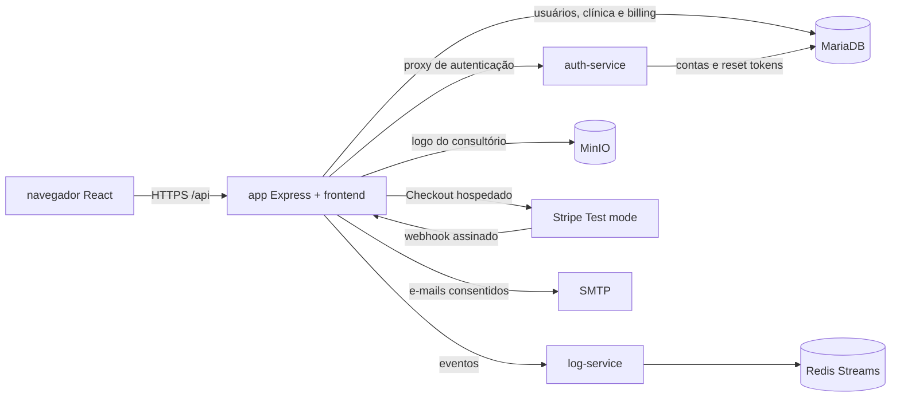

# AgendaLivre

**AgendaLivre organiza horários, pacientes e lista de espera para consultórios independentes, ajudando a equipe a reduzir vagas ociosas.**

Projeto individual da disciplina ISW055 — Introdução à Computação em Nuvem, do professor [@siriani](https://github.com/siriani). A implementação está na [branch agendalivre](https://github.com/Douglas-Felipe-Mariano/TomHanksApp/tree/agendalivre) deste repositório, conforme a decisão de reaproveitar o mesmo repositório. Isso é diferente da exigência de repositório novo publicada na atividade 9; não afirmamos que o fork foi realizado. O [relatório P2 (PDF)](docs/P2_ISW055_Douglas_Mariano.pdf) reúne a arquitetura, as atividades 7–11, as evidências disponíveis e as pendências.

> Estado honesto: issues de acompanhamento foram abertas, mas o código e a documentação desta branch não comprovam que a aplicação foi publicada na VM/subdomínio do curso, que o Stripe foi configurado no Dashboard ou que as integrações externas foram validadas. Essas etapas dependem de acesso à infraestrutura.

## 1. A dor

Consultórios pequenos organizam horários em agendas, planilhas e conversas de WhatsApp que não compartilham um estado único. Uma falta ou cancelamento pode deixar um horário vazio, enquanto outra pessoa aguarda uma vaga. A equipe também precisa conferir manualmente quem pediu retorno ou prefere determinados períodos.

O produto não registra sintomas, diagnósticos, prontuários ou outras informações clínicas. A dor atendida é operacional: acompanhar agenda, contatos administrativos, preferências de horário e autorização para comunicações gerais. O custo atual em horas ou dinheiro ainda precisa ser medido com entrevistas; não usamos estimativas inventadas como evidência de mercado.

## 2. Persona

**Ana, 38 anos**, fisioterapeuta autônoma que atende em um consultório pequeno. Ela alterna entre atendimentos, mensagens e uma planilha para confirmar horários. Quando alguém cancela, precisa procurar conversas antigas para saber quem poderia ocupar a vaga. Quer uma visão simples da rotina e controle sobre quais pacientes autorizaram receber mensagens administrativas.

## 3. Concorrentes e alternativas

- **Planilha + agenda do celular:** flexíveis e baratas, mas exigem atualização manual e não mantêm uma lista de espera integrada.
- **WhatsApp:** útil para conversar, mas difícil de usar como agenda compartilhada ou registro consistente de preferências e consentimentos.
- **Doctoralia e iClinic:** produtos de gestão/atendimento estabelecidos, que devem ser avaliados em entrevistas e comparação de planos; o AgendaLivre começa com foco menor na agenda operacional de consultórios independentes.
- **AgendaLivre:** protótipo acadêmico; não substitui software clínico, prontuário ou orientação profissional.

## 4. Proposta de valor

**Uma agenda operacional simples que conecta horários, lista de espera e retornos administrativos autorizados, sem misturar gestão de agenda com prontuário clínico.**

## 5. Receita e planos Stripe

| Plano | Preço de referência | Limites e recursos |
| --- | ---: | --- |
| Free | R$ 0/mês | Agenda, pacientes e lista de espera; até 3 novos agendamentos por mês. |
| Pro | R$ 39,90/mês | Remove o limite de novos agendamentos e habilita sugestões administrativas de retorno, encaixes da lista de espera e até 200 e-mails autorizados por mês. |

O checkout usa um preço mensal em BRL criado no Stripe **Test mode**. O identificador do preço é definido em `STRIPE_PRO_PRICE_ID`; o valor efetivo depende do preço criado na conta Stripe e deve coincidir com o modelo acima. Nenhum dado de cartão passa pelo AgendaLivre. Upgrade, downgrade e cancelamento devem ocorrer pelo Customer Portal; a API atualiza o plano somente por webhooks validados.

## 6. Métricas de sucesso

- Consultórios cadastrados e equipes ativas.
- Horários criados e taxa de ocupação da agenda.
- Pessoas contatadas a partir da lista de espera e retornos administrativos concluídos.
- Conversão Free → Pro, assinaturas Pro ativas, cancelamentos e retenção.
- MRR de teste calculado a partir das assinaturas Pro ativas sincronizadas pelo webhook.

As métricas devem ser observadas com dados de demonstração e consentimento adequado, sem incluir conteúdo clínico.

## 7. Lean Canvas

| Bloco | Hipótese inicial |
| --- | --- |
| Problema | Cancelamentos deixam horários vagos; dados de agenda ficam dispersos; a equipe procura manualmente quem aguarda uma vaga. |
| Segmentos de clientes | Consultórios independentes e pequenos, inicialmente com uma equipe enxuta e sem sistema integrado de agenda. |
| Proposta única de valor | Agenda e lista de espera simples, com controle administrativo de consentimento, sem prontuário clínico. |
| Solução | Agenda com prevenção de sobreposição; cadastro mínimo de pacientes e lista de espera; sugestões de ocupação e mensagens consentidas no Pro. |
| Canais | Indicação entre profissionais, comunidades locais, demonstrações e landing page pública. |
| Fontes de receita | Assinatura Pro mensal de referência R$ 39,90 via Stripe; plano Free para experimentação. |
| Estrutura de custos | VM/containers, MariaDB, Redis, MinIO, e-mail transacional, taxas de pagamento e manutenção. |
| Métricas-chave | Ativação, consultas por mês, ocupação, conversão, MRR, cancelamento e retenção. |
| Vantagem injusta | Ainda não comprovada. A hipótese é conhecimento próximo da rotina de consultórios pequenos; precisa ser validada com entrevistas. |

## 8. O que foi reaproveitado

| Peça do projeto-base | Papel no AgendaLivre |
| --- | --- |
| Frontend React/Vite | Landing page pública, autenticação e painel de agenda. |
| API Express | CRUD do domínio, autorização por papel e isolamento por consultório. |
| Auth Service + JWT | Cadastro, login, recuperação de senha e identidade da conta. |
| RBAC | Proprietário, recepção e profissional; o papel da equipe fica no vínculo do consultório e é conferido na API. `admin` é papel separado para métricas e auditoria. |
| MariaDB | Usuários, clínicas, equipe, pacientes, consultas, lista de espera, consentimentos e estado Stripe. |
| Log Service + Redis Streams | Eventos de negócio e auditoria, com consulta administrativa protegida. |
| MinIO | Object storage para logo público do consultório; dados de pacientes não são armazenados no bucket público. |
| Stripe | Checkout recorrente Pro, webhooks idempotentes, Customer Portal e estado local usado pela API. |
| Docker Compose | Execução conjunta de app, auth, logs, Redis e MinIO; MariaDB é externo e configurado por ambiente. |

## Arquitetura

As consultas do domínio usam `clinic_id`; o proprietário da clínica é obtido no servidor e os papéis de recepção/profissional são resolvidos pela tabela `clinic_members`. Usuários não escolhem papel privilegiado no cadastro. O webhook valida a assinatura Stripe sobre o corpo original e registra o ID do evento em `stripe_events` na mesma transação que atualiza o estado da conta.

## API principal

| Método e rota | Acesso | Uso |
| --- | --- | --- |
| `POST /api/auth/register`, `POST /api/auth/login` | Público | Cadastro e sessão. Toda nova conta começa como proprietária. |
| `GET /api/clinic/dashboard` | Membro | Visão de agenda, plano, papel e métricas do consultório. |
| `PUT /api/clinic/settings` | Proprietário | Nome e horário de funcionamento. |
| `GET/POST/DELETE /api/clinic/members` | Proprietário | Lista, vincula conta existente e remove membro da equipe. |
| `POST /api/clinic/logo` | Proprietário | Upload validado de logo para MinIO. |
| `GET/POST /api/patients` | Membro / proprietário ou recepção para criar | Consultar ou cadastrar dados mínimos de contato. |
| `GET/POST /api/appointments`, `GET/PUT/DELETE /api/appointments/:id`, `PATCH /api/appointments/:id/status` | Membro | Agenda; o servidor bloqueia sobreposição, limita o Free e restringe profissionais aos próprios atendimentos. DELETE é cancelamento lógico. |
| `GET/POST /api/waitlist` | Membro / proprietário ou recepção para alterar | Lista de espera administrativa. |
| `GET /api/premium/reactivation-candidates`, `POST /api/premium/campaigns` | Pro; campanha só proprietário | Sugestões não clínicas e mensagens gerais para contatos com consentimento ativo. |
| `POST /api/billing/checkout`, `POST /api/billing/portal` | Proprietário | Checkout recorrente e portal hospedado pelo Stripe. |
| `POST /api/billing/webhook` | Stripe | Eventos assinados e deduplicados. |
| `GET /api/admin/billing/summary`, `GET /api/admin/logs` | `admin` | Contas por plano, assinaturas ativas, MRR de teste e auditoria recente. |
| `GET /api/public/unsubscribe` | Público, HMAC | Retira consentimento usando link assinado. |

## Privacidade e segurança

- Não registrar conteúdo clínico; limitar o cadastro a nome e contato necessários à agenda.
- Consentimento de comunicação é separado do cadastro, revogável e verificado no servidor no momento do envio. As sugestões de retorno são administrativas, não recomendações clínicas.
- Consultas e alterações são limitadas ao consultório associado à sessão; papéis e limites são verificados na API, não apenas na interface.
- Logo é imagem pública de identidade do consultório. O bucket MinIO configurado pelo projeto tem leitura pública; nunca grave nele documentos ou dados de pacientes.
- Segredos devem existir somente nas variáveis do ambiente/stack. `.env.example` contém nomes e exemplos, não chaves válidas.
- Antes de produção são necessários revisão de LGPD, política de retenção/exclusão, verificação de e-mail, rate limiting, backup/restore testado, TLS, gestão de segredos e revisão independente de segurança. A implementação atual é acadêmica e não deve ser usada como prontuário.

## Rodar localmente

1. Configure um MariaDB acessível e crie o banco indicado por `DB_NAME` (padrão `agendalivre`). Aplique `database/create.sql` numa base nova.
2. Copie `.env.example` para `.env`, configure banco, JWT, URLs, MinIO e SMTP. Para checkout, informe somente `sk_test_...`, `whsec_...` e o ID de um preço recorrente mensal em modo de teste.
3. Inicie a stack com Docker Compose. O backend executa migrações de assinatura e clínica no startup; o auth-service verifica os papéis e tokens de recuperação.
4. Para desenvolvimento separado, use `npm install` e `npm run dev` em `backend/`, `auth-service/` e `frontend/`; use as URLs e serviços compatíveis definidos nos arquivos `.env.example`.

### Configurar Stripe Test mode

1. Crie o produto AgendaLivre Pro com preço recorrente mensal em BRL e valor de referência R$ 39,90; copie o ID para `STRIPE_PRO_PRICE_ID`.
2. Configure o Customer Portal em Test mode para permitir ao cliente gerenciar/cancelar a assinatura.
3. Registre `https://SEU_DOMINIO/api/billing/webhook` para `checkout.session.completed`, `customer.subscription.created`, `customer.subscription.updated`, `customer.subscription.deleted` e `invoice.payment_failed`.
4. Salve a chave secreta de teste e o segredo do endpoint em variáveis da stack. Não versione valores reais.
5. Aplique o cartão de teste `4242 4242 4242 4242`, uma data futura e qualquer CVC. A confirmação local depende da entrega do webhook; retornar do checkout não concede Pro.

### Limites dos planos

No Free, a criação do quarto agendamento do mês é recusada com HTTP 403, código `PLAN_LIMIT_REACHED`, limite e instrução para upgrade. A verificação e a escrita são serializadas pelo registro da clínica para evitar ultrapassar a franquia em requisições concorrentes. Pro remove esse limite; campanhas continuam limitadas a 200 envios consentidos por mês.

## Camadas de nuvem

| Camada | Componentes | Observação |
| --- | --- | --- |
| SaaS | AgendaLivre; Stripe, SMTP e serviços externos consumidos por API | O AgendaLivre é o produto de software entregue ao consultório. |
| PaaS (didático) | Containers Docker/Compose e serviços de aplicação | Runtime auto-hospedado, não PaaS gerenciado; equipe administra Docker e configuração. |
| IaaS | VM que hospeda Docker e a stack do curso | Sistema operacional, rede, volumes e implantação dependem da infraestrutura do curso. |

## Evidências locais e itens ainda externos ao código

Em 09/11/2026, às 23:03 (Brasília), o frontend Vite foi executado localmente e as telas públicas foram capturadas após alinhar as cores do login à landing. Elas mostram a interface, não autenticação ou operações persistidas:

- [Landing page](docs/prints/agendalivre-local-01-landing-20261109-2303.png)
- [Login](docs/prints/agendalivre-local-02-login-20261109-2303.png)
- [Cadastro](docs/prints/agendalivre-local-03-cadastro-20261109-2303.png)
- [Recuperação de senha](docs/prints/agendalivre-local-04-recuperar-senha-20261109-2303.png)
- [Redefinição sem token](docs/prints/agendalivre-local-05-reset-sem-token-20261109-2303.png)

O backend e o Docker Engine não foram iniciados nesta execução: não havia `.env`, MariaDB local nem Docker Engine disponível. Portanto, não há prova de login funcional, CRUD, deploy, checkout realmente executado, webhook recebido em conta de teste, eventos ou MinIO integrados. A atividade 9 pede repositório novo; esta branch segue a decisão de manter o mesmo repositório, portanto há uma divergência a resolver com a docente antes de declarar aquela etapa como atendida. Consulte o [relatório P2](docs/P2_ISW055_Douglas_Mariano.pdf) para os estados e limites detalhados.